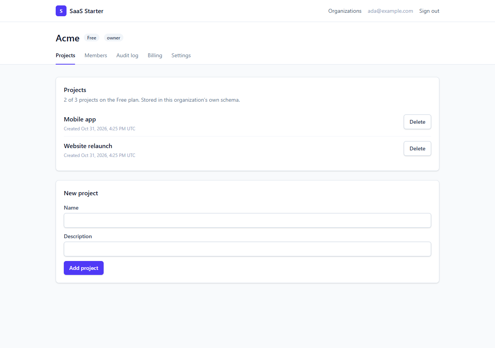
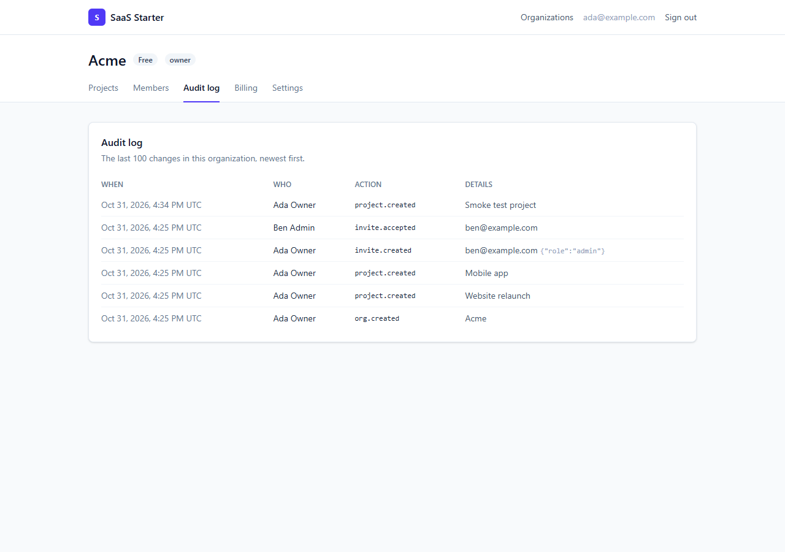

# SaaS Starter

[](https://github.com/WaifaiMT/saas-starter/actions/workflows/ci.yml)

An open-source multi-tenant SaaS starter built with **Next.js 16, TypeScript, and PostgreSQL**. Every organisation gets **its own PostgreSQL schema**, so tenant data is separated by the database, not just by a `WHERE org_id = ?` that's easy to forget.

Included: email/password auth with database sessions, organisations with owner/admin/member roles, single-use invite links, an audit log, Stripe subscription billing with plan limits, and integration tests that run against real PostgreSQL.

| Projects (per-organisation data) | Audit log |
|---|---|
|  |  |

## How tenancy works

```
public schema (shared)                    org_<id> schema (one per organisation)
├── users, sessions                       ├── projects        ← your product's tables
├── organizations (slug, schema_name)     ├── ...
├── memberships (role)                    └── _migrations     ← tracks this schema's migrations
├── invites, subscriptions
└── audit_log

Request for /o/acme/...
  → requireOrg("acme"): session → user → membership (404 if not a member)
  → withTenant(org.schemaName, db => ...)
       BEGIN; SET LOCAL search_path TO org_<id>, public; ...queries...; COMMIT
```

- **Tenant tables are unqualified** (`projects`, not `org_x.projects`), so they only resolve inside `withTenant()`. Outside it, a tenant query fails instead of reading the wrong data.
- **`SET LOCAL`** scopes the search path to one transaction, so a pooled connection never carries one tenant's schema into the next request. There's a test for exactly this.
- **Schema names come from organisation ids**, never from user input, and are checked against `^org_[0-9a-f]{32}$` before they reach SQL.
- **Non-members get a not-found page** for another organisation's URLs, so they can't even confirm it exists. Because pages stream, the status code is sent before the membership check and stays 200; Next.js marks the page `noindex`, and no data from the other organisation is ever sent.
- **Migrations run per schema.** `npm run db:migrate` updates `public` and then every organisation's schema; new organisations are migrated when they're created. Each schema records what it has applied, under an advisory lock.

Why schema-per-tenant rather than a shared table with row-level security? It gives the strongest separation short of a database per tenant, makes per-customer backup, export, and deletion simple (`DROP SCHEMA ... CASCADE`), and keeps tenant queries free of org filters. The trade-off is that migrations touch every schema, which the runner handles. It suits B2B products with hundreds to low thousands of organisations.

## Features

| Area | What's there |
|---|---|
| Auth | Email/password (bcrypt), database sessions in httpOnly cookies, **session tokens stored as SHA-256 hashes**, timing-safe login errors, safe `?next=` redirects |
| Organisations | Create, rename, delete (drops the schema); unique slugs |
| Roles | `owner`, `admin`, `member` from one permission map, checked on the server in every action; admins can't touch owners; the last owner can't leave or be demoted |
| Invites | Single-use links, expire in 7 days, only work for the invited email, tokens stored hashed |
| Audit log | Written in the same transaction as the change it records |
| Billing | Stripe Checkout subscriptions and Customer Portal behind a `BillingProvider` interface; verified webhooks; organisations matched by Stripe customer id; plan limits on projects and members |
| Example resource | Projects, stored in each organisation's own schema |
| Health check | `GET /api/health` checks the database (works with [vps-deploy-playbook](https://github.com/WaifaiMT/vps-deploy-playbook)) |

## Tests

`npm test` creates a throwaway PostgreSQL database, migrates it, runs the suite, and drops it. Highlights:

- Organisation A can't list or delete organisation B's projects, even by id
- A pooled connection doesn't keep a tenant's `search_path` after the transaction
- Invalid or injected schema names are refused before any SQL runs
- Deleting an organisation drops its schema; migrations are idempotent across tenants
- Session and invite tokens are stored only as hashes; expired and used ones are rejected
- Role rules: last-owner protection, admins can't modify owners, members can't invite
- Plan limits on projects and members; billing events upgrade, downgrade, and replay safely
- Stripe webhook signatures: valid events are parsed, forged and unsigned ones rejected

CI runs lint, type-check, the tests against a PostgreSQL service container, migrations and seed twice, and a production build.

## Getting started

Requirements: Node.js 20.9+ and PostgreSQL 15+ (local or Docker).

```bash
npm install
cp .env.example .env
docker compose up -d          # or point DATABASE_URL at your own PostgreSQL
npm run db:migrate
npm run db:seed               # optional demo data: two users, two organisations
npm run dev
```

Open http://localhost:3000 and sign in as `ada@example.com` or `ben@example.com` (password `password1234`), or create an account.

Run the tests with `npm test` (uses `TEST_DATABASE_URL`; the user needs `CREATEDB`).

## Adding a tenant table

1. Add a SQL file to `src/db/migrations/tenant/` (e.g. `0002_tasks.sql`) with unqualified table names.
2. Add the Drizzle table to `src/db/schema.ts` under the tenant section.
3. Run `npm run db:migrate` to apply it to every existing organisation.
4. Query it inside `withTenant(ctx.org.schemaName, db => ...)` in a service, after checking permissions with `assertCan`.

## Billing setup

Billing is optional; without Stripe keys every organisation stays on the free plan.

1. Create a [Stripe sandbox](https://docs.stripe.com/sandboxes) for development (or run `stripe sandbox create` with the Stripe CLI).
2. Create a Product with a recurring Price, and put the price id in `STRIPE_PRICE_ID`.
3. Use a [restricted API key](https://docs.stripe.com/keys#manage-your-api-keys) (`rk_...`) with access to Customers, Checkout Sessions, Customer Portal, and Subscriptions in `STRIPE_SECRET_KEY`.
4. Forward webhooks locally: `stripe listen --forward-to localhost:3000/api/webhooks/stripe`, and put the printed `whsec_...` in `STRIPE_WEBHOOK_SECRET`. Subscribe to `customer.subscription.created/updated/deleted`, `invoice.paid`, and `invoice.payment_failed`.

Before going live:

- **Tax:** if you charge customers in the US, EU, or other taxed regions, set up [Stripe Tax](https://docs.stripe.com/billing/taxes/collect-taxes) with an active registration. Turning on automatic tax alone collects nothing.
- **Disputes, refunds, and fraud warnings:** handle `charge.dispute.created`, `charge.refunded`, and `radar.early_fraud_warning.created` for your business process. The starter doesn't yet.
- Add Paystack (or another provider) by implementing `BillingProvider` in `src/lib/billing/`.

## Project structure

```
src/
  db/
    migrations/public/   shared tables (SQL)
    migrations/tenant/   per-organisation tables (SQL)
    migrate.ts           per-schema migration runner
    tenant.ts            withTenant(): transaction scoped to one schema
    schema.ts            Drizzle table definitions
  lib/
    services/            business logic: users, orgs, members, invites, projects, audit
    billing/             BillingProvider interface, Stripe, plans
    auth/session.ts      cookies, current user, requireOrg (the data access layer)
    permissions.ts       role → permission map
  app/                   Next.js routes: auth, /orgs, /o/[slug]/..., invites, API
tests/                   integration tests against real PostgreSQL
scripts/                 migrate and seed
```

## Roadmap

- [ ] Email delivery for invites and password reset (Resend or SMTP)
- [ ] Paystack billing provider
- [ ] End-to-end tests with Playwright
- [ ] Organisation-scoped API keys

## License

MIT
